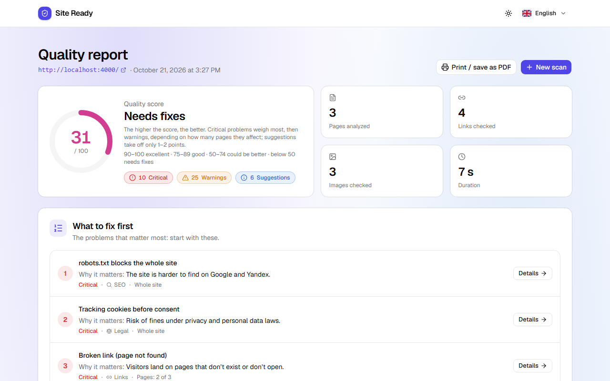
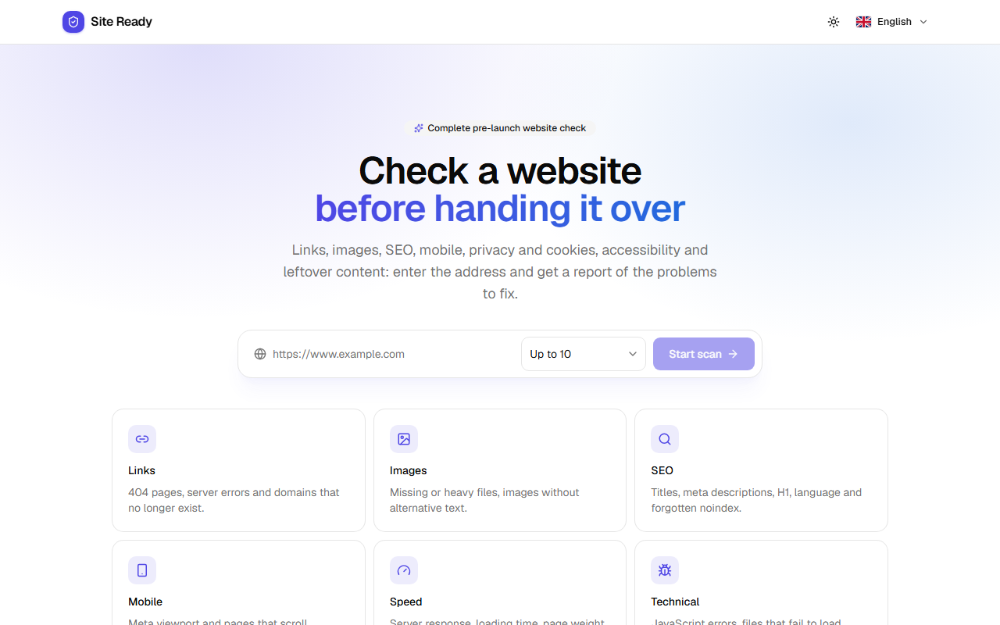
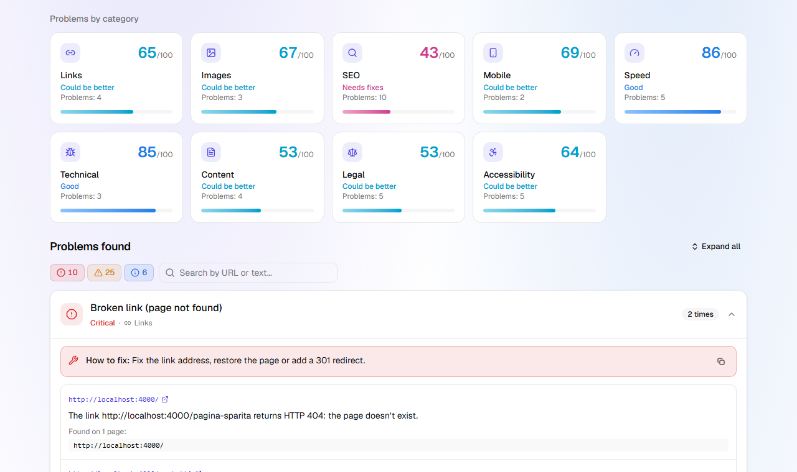
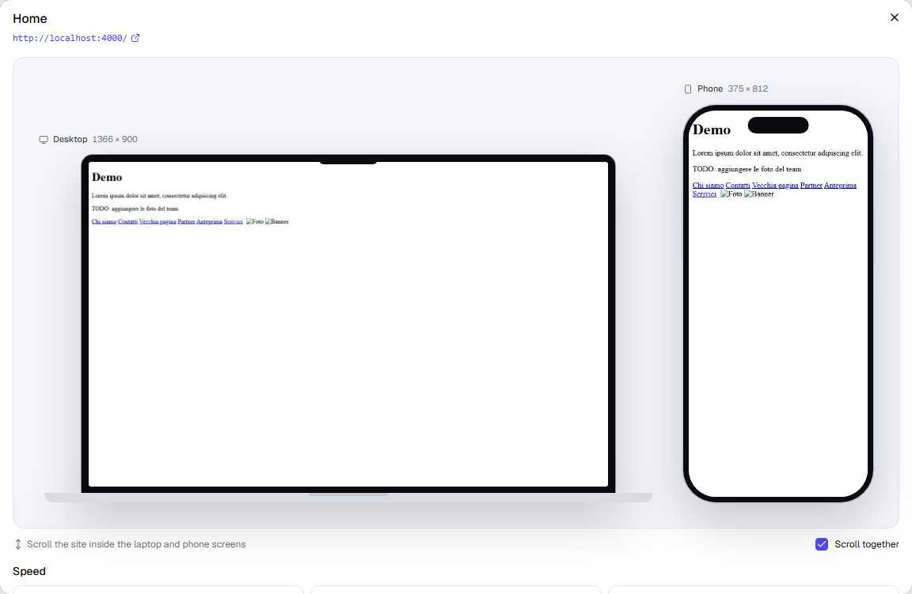
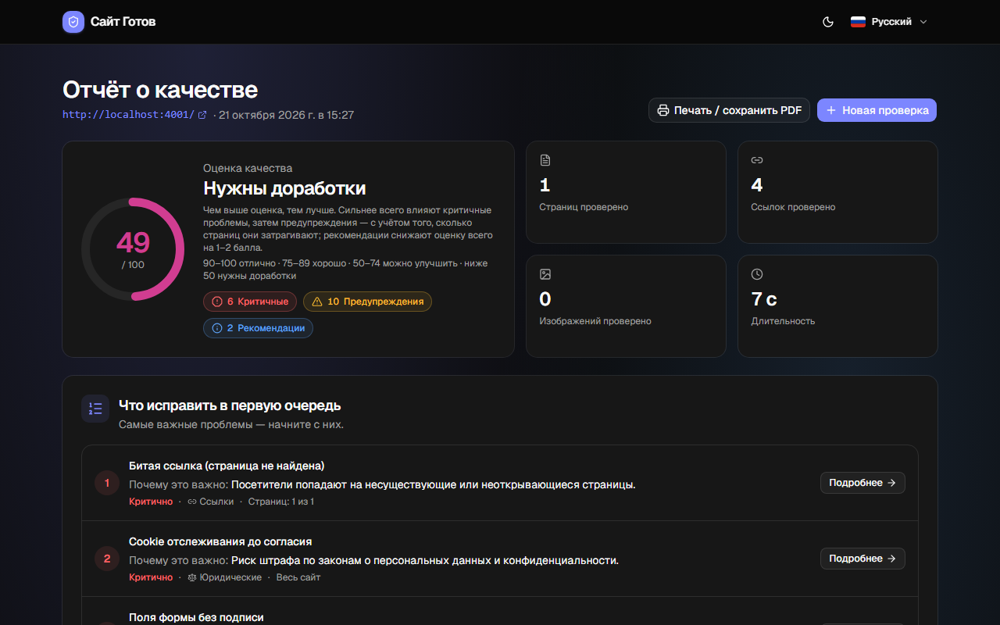

# Site Ready

[](https://github.com/ksenia-git-hub/site-ready/actions/workflows/ci.yml)

**Automated quality check for a website before it is handed over to the client.**

Enter a URL. Site Ready opens the site in a real browser on desktop and on a phone, follows the internal links and returns a scored report. The report covers broken links, SEO mistakes, forgotten placeholder content, slow pages, accessibility issues and missing legal requirements for the EU/Italy and Russia. It can be read, filtered and printed to PDF in Italian, English or Russian.



| | |
|---|---|
|  |  |
|  |  |

## Why

Web studios hand sites over with the same leftover mistakes again and again: a `noindex` still switched on from staging, `lorem ipsum` on an inner page, links pointing to `staging.example.com`, Google Analytics setting cookies before the visitor accepts, a missing VAT number or privacy policy. Site Ready finds these in about a minute. The report is written for both audiences: the developer gets a "how to fix" for every issue, and the client gets a 0–100 score with a plain-language verdict.

## What it checks

| Category | Examples |
|---|---|
| **Links** | 404/410, 5xx, dead domains, timeouts, very slow pages; external sites that block bots are only flagged as a suggestion |
| **Images** | missing files, files over 500 KB, missing `alt`, images much larger than displayed |
| **SEO** | title and meta description, H1, `lang`, a forgotten `noindex`, `robots.txt` blocking everything, sitemap, favicon, Open Graph, soft 404 |
| **Mobile** | missing viewport, horizontal scrolling at 375 px (with the elements that cause it) |
| **Speed** | server response, LCP, CLS, page weight, number of requests, compression, browser caching, legacy image formats |
| **Technical** | JavaScript errors, failed resources, mixed content, HTTPS and its redirect, certificate expiry, default server 404 page |
| **Leftover content** | lorem ipsum, links to localhost/staging, CMS demo text ("Hello world!"), fake e-mails and phone numbers, TODO/FIXME |
| **Legal: EU/Italy** | privacy and cookie policy, cookie banner when trackers are present, **tracking cookies set before consent**, Italian VAT number (P.IVA) |
| **Legal: Russia** | 152-FZ consent in forms (missing, pre-ticked, or not a real checkbox: the browser actually tries to tick it), foreign analytics services, seller details (INN/OGRN) for shops, interface text only in a foreign language (168-FZ) |
| **Accessibility** | axe-core rules (contrast, unnamed buttons/links/fields, heading order, zoom disabled, ARIA…) plus generic link text such as "click here" |

The report also includes:

- a "what to fix first" list;
- a score for each category;
- severity filters and search;
- full-page desktop and phone screenshots inside device mock-ups that scroll together;
- per-page speed metrics;
- a print-ready PDF view.

## How it works

```
client (React)  ──/api──▶  Fastify server  ──▶  scan queue  ──▶  Playwright / Chromium
   polls job status                                  │            desktop 1366 px + phone 375 px
   renders + translates                              ▼
   the report                              pure rule functions  ──▶  Issue { code, severity, params }
```

- **Crawling** is breadth-first, on the same domain, up to 50 pages. Each page is opened in a desktop and a mobile context. The scanner collects:
  - DOM data;
  - console errors and failed requests;
  - resource sizes, through the DevTools protocol with the cache disabled;
  - Core Web Vitals;
  - axe-core results;
  - two full-page screenshots.

  After that, every link and image found is checked over HTTP (HEAD with a GET fallback, limited concurrency).
- **Rules are pure functions.** They turn the collected data into issues without touching the network or the browser, so most of the logic is unit-tested with plain objects.
- **The server never sends sentences**, only codes and parameters, for example `{ code: "seo.noindex", severity: "critical", params: {...} }`. Every sentence lives in the client, translated into three languages. A test fails if any language is missing a key, a plural form or a placeholder, or if a server code has no text.
- **The score** follows the approach of SEO audit tools: each kind of problem is weighted by severity and by the share of pages it affects. The curve never reaches 0, and 100 is reserved for "nothing found". See [client/src/lib/score.ts](client/src/lib/score.ts).

### Built for a public deployment

- **Optional password** (`APP_PASSWORD`): signed HttpOnly session cookie, rate-limited login.
- **Internal-network blocking** (`BLOCK_PRIVATE_TARGETS`): the scanner must not reach the server's own network. Private, loopback, link-local and cloud-metadata addresses are refused in three places:
  - the requested URL;
  - every request the browser makes, redirects included;
  - every link and image check.
- **Limits:** at most 2 concurrent scans per client and 20 in the queue. Scans can be cancelled.
- **One Docker image** holds the API, the built interface and Chromium. It runs as a non-root user and has a health check.

## Tech stack

- **Language and runtime:** TypeScript on Node 24. The server runs `.ts` files directly through Node's type stripping, with no build step.
- **Server:** Fastify 5, Playwright (Chromium), axe-core.
- **Client:** React 19, Vite, Tailwind CSS v4, shadcn/ui, i18next (it/en/ru), lucide-react, next-themes, sonner.
- **Shared:** a `shared` workspace that holds the API contract.
- **Tests:** Vitest, including end-to-end scans with a real Chromium.

## Run it locally

Requires Node.js 24 or newer.

```bash
npm install
npx playwright install chromium

npm run demo-site   # terminal 1: demo sites with deliberate mistakes on :4000 (Italian) and :4001 (Russian shop)
npm run dev         # terminal 2: open http://localhost:5173 and scan localhost:4000
```

Other commands:

```bash
npm test            # all tests
npm run typecheck   # tsc on every workspace
npm run build       # build the client into client/dist
npm start           # server only; serves client/dist on :3000 when it exists
```

Configuration is documented in [.env.example](.env.example). Production with Docker:

```bash
docker build -t site-ready .
docker run -p 3000:3000 -e APP_PASSWORD=change-me site-ready
```

The image already sets `HOST=0.0.0.0`, `BLOCK_PRIVATE_TARGETS=true` and `TRUST_PROXY=true`. Give the container about 2 GB of memory for Chromium and full-page screenshots.

## Testing and CI

- **96 automated tests** (Vitest):
  - unit tests for every rule file;
  - API tests with a fake scanner;
  - security tests for the login, the rate limiter and the private-address guard;
  - translation-completeness tests;
  - **end-to-end tests** that start the demo sites, scan them with a real Chromium and assert that exactly the planted problems are found, with screenshots for every page. They also cover cancelling a scan and the private-address guard.
- **GitHub Actions** ([.github/workflows/ci.yml](.github/workflows/ci.yml)) runs on every push and pull request:
  - type checking, tests (with Chromium) and the production build;
  - a Docker image build.

## How this was built with AI

The project was built with **Claude Code** (Anthropic's coding agent, Claude Opus model) in VS Code, in a long series of short iterations. The working loop was:

1. I described the goal or the problem in plain language, often with a screenshot or the result of a real scan.
2. The agent proposed an approach, and I approved it, redirected it or asked for alternatives first.
3. The agent wrote the code and the tests and ran the type checker, the test suite and a browser check.
4. I tried the result in the browser, often on real client sites, and gave feedback.

**Generated by the AI:**

- almost all of the code, tests, translations and documentation;
- research I asked for (how SEO audit tools compute their scores, current Russian requirements on consent and foreign analytics);
- the browser-automation scripts used to verify the interface.

**Decided, reviewed and corrected by me:**

- **Product and scope:** the idea, who the report is for, which checks matter at handover, the three languages, and the name.
- **Domain input:** the Russian legal checks (152-FZ consent, foreign analytics, seller details, the 168-FZ language rule) and the consent-checkbox test were my requests based on client work. I decided what is critical and what is only a warning.
- **Testing on real sites** surfaced problems the tests didn't catch:
  - a slow but working site was reported as unavailable;
  - the score was too harsh: a decent site got 0/100. I asked for research into how other tools compute theirs and for a new formula;
  - info-level suggestions didn't affect the score at all, so a site with problems could still get 100;
  - the page filters were duplicated;
  - labels overflowed.
- **UI/UX review** of every screen:
  - wording, including the Russian category names;
  - a color palette that stays in a cool IT style instead of "dirty" gradients;
  - clickable severity chips and category tiles;
  - device mock-ups in a Figma style that scroll together;
  - a "what to fix first" block at the top of the report.
- **Security and deployment:** I made sure the agent kept secrets out of the repository, added a login, blocked the internal network and made the app ready for a public deployment.

[CLAUDE.md](CLAUDE.md) is the project brief the agent reads at the start of every session: structure, conventions and how to add a new check. [HANDOFF.md](HANDOFF.md) is the running status note kept between sessions. Both are part of the AI workflow and are kept in the repository on purpose.

## Known limitations

- The scan queue lives in memory: reports are lost on restart, and only one scan runs at a time.
- Speed is measured without network throttling and without Lighthouse: it is a guide, not an official Google score.
- Some checks are heuristic: cookie banners, privacy and cookie policy links, the VAT number pattern.
- The private-network guard checks the IP at DNS resolution time. A targeted DNS-rebinding attack is still theoretically possible.
